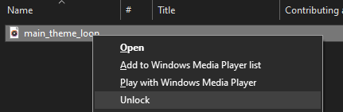
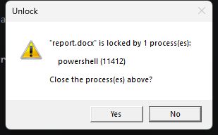

# File Unlocker

**File Unlocker** is a small tool for MS Windows that closes the processes holding a file or a folder, so you can move, rename or delete it. It can be reached from the File Explorer context menu, or used directly from a command line. The three-click workflow is the point of the integration:



*The `Unlock` entry as it appears in Explorer's context menu.*



*The confirmation dialog. Its title bar reads `Unlock`.*

## What it does and what it does not do

It asks the Windows **Restart Manager** which processes currently hold open handles on the item, shows them to you, and closes them after you confirm. It then re-checks the item to confirm it is really free.

- **It does not unlock anything itself.** There is no bypass of a lock; it frees the item by closing the processes that hold it.
- It does not ask for administrator rights. If a process cannot be closed without them, it reports that instead.
- It does not touch the registry while it runs, and it sends nothing anywhere.

## Requirements

| | |
|---|---|
| Operating system | 64-bit Windows 10 or Windows 11 |
| To run the published build | the **.NET 10 Desktop Runtime** |
| To build from source | the **.NET 10 SDK** |
| Administrator rights | not needed for per-user install or for normal use |

## Installation

Download a release from the [releases page](https://github.com/marianpekar/file-unlocker-for-windows/releases), unpack it into a folder of your choice, and run `install.bat` from that folder. `install.bat` lives next to `FileUnlocker.exe`, so run it from there.

### Per-user install (default)

```
install.bat
```

No administrator prompt is needed. The script registers three Explorer verbs under `HKCU\Software\Classes`:

| Key | Applies to | Command value |
|---|---|---|
| `HKCU\Software\Classes\*\shell\FileUnlocker` | any file | `"<folder>\FileUnlocker.exe" "%1"` |
| `HKCU\Software\Classes\Directory\shell\FileUnlocker` | a folder | `"<folder>\FileUnlocker.exe" "%1"` |
| `HKCU\Software\Classes\Directory\Background\shell\FileUnlocker` | empty space inside a folder | `"<folder>\FileUnlocker.exe" "%V"` |

Each verb also gets an `Icon` value pointing at `key.ico`, and the file verb gets `MultiSelectModel` set to `Single`. The default menu label is `Unlock`. The per-user scope works without elevation because Windows merges `HKCU\Software\Classes` into the `HKEY_CLASSES_ROOT` view that Explorer reads.

### Machine-wide install

```
install.bat /allusers
```

This writes the same three verbs to `HKEY_CLASSES_ROOT` and refuses to run unless the prompt is elevated. Because the registered commands store **absolute paths**, moving the folder after installing breaks the menu entries — run `remove.bat` and `install.bat` again from the new location.

### Verifying and removing by hand

You can inspect or delete the entries with `reg.exe`:

```
reg query "HKCU\Software\Classes\*\shell\FileUnlocker" /s
reg delete "HKCU\Software\Classes\*\shell\FileUnlocker" /f
```

`remove.bat` removes all three verbs and is safe to run twice; `remove.bat /allusers` removes the machine-wide entries (elevated prompt required).

## Build and install in one step

`build-and-install.ps1` finds a .NET SDK on the machine (or downloads one into a cache folder), builds the project from a throwaway copy, publishes it into a permanent folder outside the repository, registers the Explorer context menu, and then runs the installed executable to prove it works. It never modifies the repository and cleans up its temporary build folder on every path, including failure.

Before anything is copied or deleted, the script checks that `-InstallDir` is a sensible place for an install folder, and it proves the build starts before it copies anything into that folder.

### Running it

Double-click `build-and-install.cmd` in the repository root; it runs the PowerShell script with the execution policy bypassed for that one process, then pauses so the output can be read. Any arguments are passed straight through, for example `build-and-install.cmd -Uninstall`.

From a PowerShell prompt:

```powershell
.\build-and-install.ps1
```

### Parameters

| Parameter | Default | Meaning |
|---|---|---|
| `-InstallDir` | `%LOCALAPPDATA%\Programs\FileUnlocker` | Where the tool is installed. |
| `-Runtime` | `win-x64` | Runtime identifier to publish for. The only other accepted value is `win-arm64`. |
| `-FrameworkDependent` | off (self-contained single file) | Publish without bundling the .NET runtime. Smaller output, but the matching runtime must be installed. |
| `-AllUsers` | off (current user) | Register the Explorer menu for all users instead of the current user. Needs administrator rights. |
| `-SkipInstall` | off | Build and install the files only; do not touch the context menu. |
| `-Uninstall` | off | Remove the menu entries and delete `-InstallDir`, then stop. Never builds. |
| `-NoDownload` | off | Never download an SDK; fail with instructions if none is usable. |
| `-SdkDir` | `%LOCALAPPDATA%\FileUnlockerSdk` | Where a downloaded SDK is cached and looked up. |
| `-Quiet` | off | Print only warnings, errors and the final summary. |

### Examples

```powershell
# Default: self-contained install for the current user, menu registered.
.\build-and-install.ps1

# Smaller output; needs the matching .NET runtime on the machine.
.\build-and-install.ps1 -FrameworkDependent

# Register the menu for every user (a UAC prompt appears).
.\build-and-install.ps1 -AllUsers

# Install to a folder of your choice, including one with spaces.
.\build-and-install.ps1 -InstallDir "D:\Tools\File Unlocker"

# Build and install the files, but leave the context menu alone.
.\build-and-install.ps1 -SkipInstall

# Remove the menu entries and delete the install folder.
.\build-and-install.ps1 -Uninstall

# Use a folder that already contains an SDK and never touch the network.
.\build-and-install.ps1 -NoDownload -SdkDir "C:\Program Files\dotnet"

# Only warnings, errors and the final summary.
.\build-and-install.ps1 -Quiet
```

### What it writes and where

* The application goes into the install folder, by default `%LOCALAPPDATA%\Programs\FileUnlocker`. The folder receives `FileUnlocker.exe`, `install.bat`, `remove.bat` and `key.ico`.
* A downloaded SDK is cached under `%LOCALAPPDATA%\FileUnlockerSdk`. Nothing else outside the repository is written unless a download is needed.
* The context menu is registered once, either per user (`HKCU\Software\Classes\*\shell\FileUnlocker`, `...\Directory\shell\FileUnlocker` and `...\Directory\Background\shell\FileUnlocker`) or, with `-AllUsers`, machine-wide under `HKEY_CLASSES_ROOT`. `-SkipInstall` skips this step and says so.
* The build is verified in the staging folder **before** anything is installed, so a build that cannot start leaves no half-installed folder behind. The script then verifies the copy in the install folder again as a final check.

### Which folders the script refuses, and what it will not delete

`-InstallDir` is refused, with exit code `1` and without touching anything, when the resolved path:

* is a drive or share root (`C:\`, `\`, `/`, `\\server\share`),
* contains the repository or the temp folder, or lies inside the temp folder,
* is a system or personal folder: `%USERPROFILE%`, `%LOCALAPPDATA%`, `%APPDATA%`, `%TEMP%`, `%WINDIR%`, `Program Files`, `Program Files (x86)`, `%ProgramData%`, the system drive, or the Desktop, Documents and Downloads folders,
* or sits directly under a drive root, such as `C:\FileUnlocker`. Put it inside a subfolder instead, as in `C:\Tools\FileUnlocker`.

The same check runs before `-Uninstall` deletes anything, so a typo cannot turn into a recursive delete of a system folder.

Copying is non-destructive unless the folder is provably an install of ours. When the install folder contains `FileUnlocker.exe` and **nothing else but** `install.bat`, `remove.bat` and `key.ico`, the copy mirrors and removes stale files left by an older version. If the folder holds any other file, the script copies the build in without deleting anything, and says which of the two it did. Files that are already there are therefore never removed from a folder that also holds your own data.

### Why install outside `bin\Release`

The registered commands store **absolute paths** to the executable and the icon. A folder inside `bin\Release` is wiped by the next build and changes whenever the configuration changes, so the menu would silently point at a file that no longer exists. Installing into a fixed folder keeps the registered paths valid across rebuilds.

### When only an older SDK is available

The project targets a recent .NET version. If the machine only has an older SDK, the script retargets a **throwaway copy** of the project to that SDK's framework and says so, then builds from that copy. The repository itself is never modified; the script even compares `git status --porcelain` before and after and warns loudly if the repository changed.

### Troubleshooting the script

* **`-InstallDir` was refused.** The message names the path and the reason. Point at a folder inside a subfolder (for example `D:\Tools\FileUnlocker`), or omit `-InstallDir` for the default; the script explains this in the message and never touches the refused folder.
* **No internet and no SDK.** The download fails and the script exits with code 1, listing `winget install Microsoft.DotNet.SDK.10` and the `-SdkDir` option. Re-run with `-NoDownload -SdkDir <a folder that already contains an SDK>`.
* **UAC declined for `-AllUsers`.** Elevation is refused or cancelled, the script reports it and exits 1 without claiming the menu was registered. Run it again from an elevated prompt, or drop `-AllUsers` to install for the current user.
* **The executable does not start after `-FrameworkDependent`.** That build needs the matching .NET runtime. Re-run without `-FrameworkDependent` for a self-contained install, which bundles the runtime.
* **Any other build failure.** The script prints the last lines of the failing command's own output, so the reason (a missing runtime pack, a restore error, a proxy problem) is visible without re-running anything by hand. Ordinary progress text from `dotnet` and NuGet goes to stderr and is captured and shown rather than treated as a crash.
* **SmartScreen or an antivirus warning.** A self-contained single-file executable is a large unsigned binary, so Windows or a third-party scanner may warn the first time it runs. Allow it, or use a release build signed by the publisher.

## Usage

### From Explorer

Right-click a file, a folder, or empty space inside a folder and choose **Unlock**. A dialog lists the processes holding the item; the confirmation defaults to **No**, so pressing Enter by accident changes nothing. Answer **Yes** to close them.

### From the command line

```
FileUnlocker.exe <path> [options]
```

Exactly one path is accepted.

| Option | Meaning |
|---|---|
| `-s`, `-silent` | Close the locking processes without asking. No dialog is shown. |
| `-h`, `-help`, `-?` | Show help and exit. |
| `-v`, `-version` | Show the version and exit. |
| `--` | End option parsing; the next token is taken as the path, even if it starts with `-`. |

How a token is classified:

- Every option also accepts a `/` prefix (`/silent`, `/SILENT`), and matching is case-insensitive.
- A token that starts with `-` is **always** an option. A lone `-` is therefore an unknown option, not a path.
- A token that starts with `/` is an option **only** when its bare name is exactly `silent`, `s`, `help`, `h`, `?`, `version` or `v`. Anything else — `/etc`, `/x` — is an ordinary path.
- Options may appear before, after or between positionals.
- A second positional is a usage error.
- `-help` and `-version` win over everything else, including a bad path, and exit `0`.
- A drive root or share root (`C:\`, `\`, `/`, `\\server\share`) is refused: point at a file or a folder inside it.

### Exit codes

| Code | Meaning |
|---|---|
| `0` | The item is not locked, or all locking processes were closed. |
| `1` | Usage error (bad arguments, or a refused path such as a drive root). |
| `2` | The path was not found, is not accessible, or could not be checked. |
| `3` | Nothing could be closed (for example, it needs administrator rights). |
| `4` | Partial: some processes could not be closed, or the item is still locked afterwards. |
| `5` | Cancelled — you answered **No**. Nothing was changed. |
| `6` | Unexpected error. |

### Output lines

Informational and result lines are written to **stdout**, each prefixed `FileUnlocker: `. Errors are written to **stderr** as `FileUnlocker: error: <message>`; a usage error adds a second line, `FileUnlocker: run 'FileUnlocker.exe -help' for usage.`

| Line | Meaning |
|---|---|
| `unlocking <path>` | The run started; the path is the resolved, absolute one. |
| `<n> locking process(es)` | How many processes hold the item. |
| `  <name> (<pid>)` | One indented line per process; ` [critical]` is appended for shell or critical processes. |
| `note: the directory contains no files` | The folder was empty, so nothing was checked. |
| `note: N file(s) could not be registered and were skipped` | The Restart Manager refused some files; the result is incomplete. |
| `note: some folders could not be read; the result may be incomplete` | The folder walk stopped early; the result is incomplete. |
| `killed <name> (<pid>)` | The process was closed. |
| `failed <name> (<pid>): <reason>` | The process was asked to close but did not. |
| `skipped <name> (<pid>): protected system process` | A protected process was deliberately left alone. |
| `result: nothing locked` | The item was not locked (or is free now). |
| `result: unlocked` | The item was locked and every locker was closed. |
| `result: still locked (<n> process(es))` | Some lockers remain. |
| `result: cancelled` | You answered **No**. |

> **A `note:` line means the answer is incomplete.** The run could not check everything it was asked to check. When *nothing at all* could be registered, File Unlocker does **not** pretend the item is free: it exits `2` instead of reporting `result: nothing locked`.

> The `-help` text is printed **unprefixed**. It is a usage block, not an informational line.

### Examples

The paths below are illustrative (`C:\data`). Each block shows the output and the exit code.

To print the version, run `FileUnlocker.exe -version`, which writes `FileUnlocker: 1.2.0` and exits `0`.

```
FileUnlocker.exe -silent "C:\data\plain.txt"
FileUnlocker: unlocking C:\data\plain.txt
FileUnlocker: result: nothing locked
rem exit 0 — the file is not locked
```

```
FileUnlocker.exe -silent "C:\data\locked.txt"
FileUnlocker: unlocking C:\data\locked.txt
FileUnlocker: 1 locking process(es)
FileUnlocker:   notepad (8124)
FileUnlocker: killed notepad (8124)
FileUnlocker: result: unlocked
rem exit 0 — the locker was closed
```

```
FileUnlocker.exe "C:\data\locked.txt"
rem interactive: a dialog lists the processes and asks; No leaves everything as it was
rem exit 0 if closed, exit 5 if you answered No
```

```
FileUnlocker.exe -silent "C:\data\somefolder"
FileUnlocker: unlocking C:\data\somefolder
FileUnlocker: note: the directory contains no files
FileUnlocker: result: nothing locked
rem exit 0 — the folder was empty
```

```
FileUnlocker.exe -silent "C:\data\missing.txt"
FileUnlocker: error: "C:\data\missing.txt" does not exist or is not accessible.
rem exit 2 — the file is missing
```

```
FileUnlocker.exe -- "-weird name.txt"
FileUnlocker: unlocking C:\data\-weird name.txt
FileUnlocker: result: nothing locked
rem exit 0 — '--' let a path starting with '-' through
```

```
FileUnlocker.exe -silent -x "C:\data\plain.txt"
FileUnlocker: error: unknown option '-x'.
FileUnlocker: run 'FileUnlocker.exe -help' for usage.
rem exit 1 — unknown option
```

```
FileUnlocker.exe -silent "C:\data\a.txt" "C:\data\b.txt"
FileUnlocker: error: unexpected argument 'C:\data\b.txt'.
FileUnlocker: run 'FileUnlocker.exe -help' for usage.
rem exit 1 — only one path is accepted
```

```
FileUnlocker.exe -silent C:\
FileUnlocker: error: "C:\" is a drive root; point at a file or a folder inside it instead.
FileUnlocker: run 'FileUnlocker.exe -help' for usage.
rem exit 1 — a drive root is refused
```

## How it works

1. The path is resolved, checked for existence and accessibility, and refused if it is a drive root or share root.
2. A folder is expanded to its **files** — directories cannot be registered with the Restart Manager themselves. Reparse points are skipped and recursion stops at 64 levels deep, with a maximum of 512 files registered per batch.
3. The processes holding those files are listed and shown.
4. After confirmation, each process is closed with `Kill(entireProcessTree: true)`, so its child processes die too.
5. The files are registered again to confirm the item is really free; a process that exited during the second pass is not reported as still locking it.

It never unlocks anything by itself: it frees the item by closing its users.

## Safety

- **Protected processes are never closed.** Processes named `System`, `Idle`, `Registry`, `Memory Compression`, `Secure System`, `smss`, `csrss`, `wininit`, `services`, `lsass`, `winlogon`, `fontdrvhost`, `dwm` and `LogonUI`, plus PID 0 and PID 4, and File Unlocker's own process, are left alone. They are reported as `skipped ... protected system process`, and the item is reported as still locked.
- **Closing a process discards its unsaved work.** Closing the shell or another critical process is allowed, but it is called out: ` [critical]` is appended in the console output and the dialog shows a warning paragraph. Explorer itself may be closed, which closes the desktop shell until it restarts.
- **The tree kill is not limited to the process you see.** `Kill(entireProcessTree: true)` closes the process and its children.
- **Drive roots and share roots are refused** with exit `1`. Unlocking `C:\` would walk an entire volume and, in silent mode, close every process holding any file on it.
- **File Unlocker never asks for elevation itself.** If it cannot close a process, it says so; re-run it as administrator to try again.

## Troubleshooting

| Symptom | Cause | What to do |
|---|---|---|
| Nothing happens when you double-click `FileUnlocker.exe` | The tool needs a path; with no usable argument line it writes a usage error and exits `1`. Without a console window, that error is invisible. | Run it from the context menu, or pass a path from a Command Prompt. |
| "result: nothing locked" although the file seems locked | The lock is on another file in the same folder, the item is on a network drive that is offline, or a `note:` line was printed saying the check was incomplete. | Read any `note:` line. Point at the exact file. Re-check with the application that uses the file. |
| Exit 3 or 4 | A locker is a protected system process (3), or needs administrator rights, or the item is still locked after the attempt (4). | Read the `skipped`/`failed` lines. Re-run File Unlocker as administrator. A service holding the item may restart itself afterwards. |
| A `note:` line appeared | The result is incomplete: files were skipped, or some folders could not be read, or nothing at all could be registered (that last case exits `2`). | Re-run as administrator, or point at a narrower path. |
| Closing failed with access denied | The locker is owned by another user or by `SYSTEM`. | Re-run File Unlocker as administrator. |
| The menu entry is missing after moving the folder | The registered commands store absolute paths. | Run `remove.bat`, then `install.bat` again from the new location. |
| A large folder takes a while | Folders are walked recursively, up to 64 levels deep. | Let it finish; pointing at a subfolder is faster. |
| A path with spaces is not found | Unquoted paths are split into several tokens. | Quote it: `FileUnlocker.exe "C:\my data\file.txt"`. |
| A path starting with `-` is rejected as an unknown option | A token starting with `-` is always an option. | Put `--` before it: `FileUnlocker.exe -- "-weird.txt"`. |

## Building from source

For a build that also installs to a permanent folder and registers the menu, use `build-and-install.ps1` (see [Build and install in one step](#build-and-install-in-one-step)); the command below is the manual equivalent.

```
dotnet build FileUnlocker.sln -c Release
```

The output is written to `FileUnlocker\bin\Release\net10.0-windows\`, with `install.bat`, `remove.bat` and `key.ico` copied next to `FileUnlocker.exe`.

### Regression test

`FileUnlocker\tools\smoke-test.ps1` is a 56-assertion regression test that checks the documented exit codes and output lines. Run it from the source tree:

```
powershell -ExecutionPolicy Bypass -File FileUnlocker\tools\smoke-test.ps1 -Exe FileUnlocker\bin\Release\net10.0-windows\FileUnlocker.exe
```

It needs no administrator rights, does not touch the registry, and kills only the scratch holder processes it starts. The interactive dialog is not automated, so the Yes/No path is verified by hand.

## Repository layout

| Path | Contents |
|---|---|
| `FileUnlocker/Program.cs` | Entry point; turns every failure into a documented exit code. |
| `FileUnlocker/CommandLine.cs` | Argument parsing and the help text. |
| `FileUnlocker/FileUnlocker.cs` | Orchestration: validate, enumerate, confirm, close, re-check. |
| `FileUnlocker/RestartManager.cs` | Thin wrapper over the Restart Manager API (`rstrtmgr.dll`). |
| `FileUnlocker/ProcessKiller.cs` | Closes a process and its tree. |
| `FileUnlocker/LockingProcess.cs` | Model of one locking process and its classification. |
| `FileUnlocker/Output.cs` | Console output; every line is prefixed and every write is guarded. |
| `FileUnlocker/Message.cs` | The `Unlock` dialogs. |
| `FileUnlocker/ExitCodes.cs` | The exit-code constants. |
| `FileUnlocker/install.bat`, `remove.bat` | Context-menu registration and removal. |
| `FileUnlocker/tools/smoke-test.ps1` | The regression test. |
| `images/` | The screenshots used above. |

## Privacy

Everything happens locally. File Unlocker sends nothing anywhere and writes nothing to disk or the registry at run time.

## License and credits

Released under the [MIT License](LICENSE).

Copyright (c) 2021 Marian Pekár.
